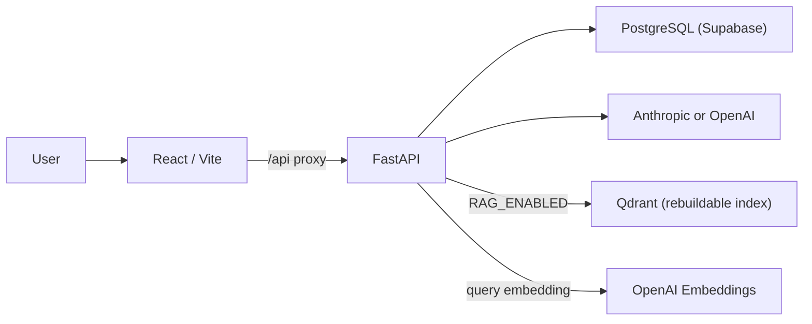

# VieTaxLegal

VieTaxLegal is a Vietnamese-language assistant for looking up tax and business law. It has a React
frontend, a FastAPI backend, a PostgreSQL database (Supabase) and an AI layer that can switch between
Anthropic and OpenAI.

The current version has accounts, a legal chat with per-user history, and a RAG pipeline: legal
corpus → Qdrant index → retrieval (dense, sparse or hybrid) → an answer that cites real sources. RAG
is off by default (`RAG_ENABLED=false`); see [backend/README.md](backend/README.md#ai-and-rag) to
build the index and turn it on.

This is a graduation thesis project and is still in progress.

## Feature status

| Feature                                                        | Status          |
| -------------------------------------------------------------- | --------------- |
| Register, sign in, sign out, session check                     | Done            |
| Email verification code before registration (needs SMTP)       | Done            |
| Google sign-in and account linking (needs OAuth client)        | Done            |
| HTTP-only session cookies, Argon2id passwords                  | Done            |
| Rotating refresh tokens, admin role, login throttling          | Done            |
| Streaming chat over SSE                                        | Done            |
| Save, open and delete conversations                            | Done            |
| Anthropic and OpenAI providers (via LangChain)                 | Done            |
| Per-minute and per-day chat limits                             | Done            |
| Vietnamese / English interface                                 | Done            |
| Legal corpus (23 documents, 21 indexed) and Điều/Khoản parser  | Done            |
| Qdrant index, OpenAI embeddings, dense / sparse / hybrid       | Done            |
| Query rewriting, reranking, "no source" gate (optional)        | Done            |
| Real citations: stored, returned and shown                     | Done            |
| RAG evaluation (questions, metrics, runner, comparison, export) | Done\*          |
| Tax calculation, contract scanning, file attachments           | Not built       |

\* The evaluation questions still need human review. Until then every result is marked
`provisional` and must not be quoted as a final number.

When RAG is off or finds nothing, the assistant shows no sources, never invents document numbers or
articles, and always reminds the user to check that a document is still in force.

## Architecture



The backend is the only layer that touches application data; the frontend never connects to the
database. The database is Supabase-managed PostgreSQL reached through the Session pooler, so no
local PostgreSQL install is needed. Qdrant runs in Docker.

## Tech stack

- Frontend: React 18, Vite 5, React Router 6, Tailwind CSS v4, React Markdown (JavaScript, no
  TypeScript).
- Backend: Python 3.12+, FastAPI, Uvicorn, Pydantic.
- Database: PostgreSQL on Supabase, SQLAlchemy 2, Alembic, Psycopg 3.
- Auth: Argon2id (`pwdlib`), JWT (`PyJWT`), HTTP-only cookies.
- AI: LangChain (`langchain-anthropic` or `langchain-openai` Responses API) for chat and OpenAI
  embeddings. Qdrant retrieval, sparse vectors, RRF fusion, chunking and citations are hand-written.
- RAG: Qdrant (Docker), OpenAI `text-embedding-3-small`, dense, sparse (hand-written BM25) and hybrid
  (RRF) retrieval.
- Streaming: Server-Sent Events (SSE).
- Quality: Pytest, Ruff, Vitest, ESLint, Prettier; GitHub Actions CI for both sides.

## Repository layout

```text
VieTaxLegal/
├── backend/
│   ├── app/
│   │   ├── api/           # FastAPI routes and dependencies (current user, roles)
│   │   ├── core/          # settings, security, errors, logging
│   │   ├── db/            # SQLAlchemy engine and session
│   │   ├── models/        # database models
│   │   ├── schemas/       # Pydantic request/response schemas
│   │   └── services/      # admin.py, auth/, chat/, rag/{ingest,index,retrieve}
│   ├── corpus/            # legal documents: source of truth for the index
│   ├── rag_eval/          # evaluation harness, configs and results
│   ├── scripts/           # corpus_*, eval_*, admin_create
│   ├── migrations/        # Alembic migrations
│   ├── tests/             # backend tests
│   └── README.md          # backend details
├── frontend/
│   ├── src/
│   │   ├── components/    # admin/, auth/, chat/, common/, landing/
│   │   ├── context/       # AuthContext and useAuth
│   │   ├── data/          # static landing and chat content
│   │   ├── i18n/          # translator and VI/EN catalogs
│   │   ├── pages/         # Landing, Chat, Settings, Admin
│   │   ├── services/      # API calls and SSE client
│   │   └── styles/        # index.css: Tailwind tokens and base rules
│   ├── nginx.conf         # production static server + /api proxy
│   └── README.md          # frontend details
├── docker-compose.yml     # Qdrant + backend + frontend
└── .github/workflows/     # backend and frontend CI
```

## Requirements

- Node.js 20.19+, 22.13+ or 24+, and npm.
- Python 3.12 or newer.
- A Supabase project (its Session pooler URL is `DATABASE_URL`).
- An Anthropic or OpenAI API key for real chat answers.
- Docker Desktop, only for Qdrant (RAG) or the Compose setup.

## Quick start on Windows

### 1. Backend

```powershell
cd D:\VieTaxLegal\backend
Copy-Item .env.example .env
notepad .env
```

Put the Supabase Session pooler URL in `DATABASE_URL` (see
[backend/README.md](backend/README.md#1-connect-the-database-supabase)), generate a `JWT_SECRET` of at
least 32 characters and configure one AI provider. Never commit the database password, JWT secret or
API keys.

```powershell
py -m venv .venv
.\.venv\Scripts\python.exe -m pip install -c constraints.txt -e ".[dev]"
.\.venv\Scripts\python.exe -m alembic upgrade head
.\.venv\Scripts\python.exe -m uvicorn app.main:app --reload --port 5000
```

`alembic upgrade head` changes the real Supabase database. Keep the backend terminal open and check:

- Health: <http://127.0.0.1:5000/api/health>
- Swagger UI: <http://127.0.0.1:5000/docs>

### 2. Frontend

In a second terminal:

```powershell
cd D:\VieTaxLegal\frontend
npm install
npm run dev
```

Open <http://localhost:3000>. Vite forwards every `/api` request to `http://localhost:5000`.

## Docker Compose

One command starts Qdrant, the backend and the frontend (nginx serving the build and proxying
`/api`). There is no Postgres container: the database is still Supabase, passed in as
`DATABASE_URL`. The backend does **not** run migrations on start, because the database holds real
data; run them by hand when needed with `docker compose run --rm backend alembic upgrade head`.

```powershell
$env:DATABASE_URL = "postgresql://postgres.<project-ref>:<password>@aws-0-<region>.pooler.supabase.com:5432/postgres"
$env:JWT_SECRET = "a-random-string-of-at-least-32-characters"
$env:ANTHROPIC_API_KEY = "..."   # or OPENAI_API_KEY + CHAT_PROVIDER=openai
docker compose up --build
```

Open <http://localhost:3000>. The same variables can live in a `.env` file at the repository root
(gitignored). Compose does not read `backend/.env`: set `RAG_ENABLED=true` and, if wanted,
`RAG_QUERY_PLANNER_MODEL`, `RAG_RERANK_MODEL` (+ `COHERE_API_KEY`), `RAG_MIN_TOP_SCORE` and
`RAG_EXPAND_ARTICLES` in the root `.env`.
`backend/corpus/` is mounted read-only; build the Qdrant index with `scripts/corpus_ingest.py`. If a
standalone Qdrant container is running (`scripts/start-qdrant.ps1`), stop it first: both use port
6333.

## Authentication and roles

- **Access token**: short-lived JWT (`ACCESS_TOKEN_MINUTES`, default 15) in the HTTP-only cookie
  `vietaxlegal_session`.
- **Refresh token**: random string, stored only as a SHA-256 hash in `refresh_tokens`, in the
  HTTP-only cookie `vietaxlegal_refresh` scoped to `/api/auth`. Each use revokes it and issues a new
  one; reusing an old token revokes the whole session family. Lifetime is 24 hours, or 30 days with
  "remember me".
- **Sign-out** revokes the session on the server. Deactivating a user (`isActive=false`) revokes all
  of that user's sessions.
- **Roles**: `users.role` is `user` or `admin`; `require_role(...)` returns `403 FORBIDDEN`. The
  first admin can only be created with `scripts/admin_create.py`; there is no HTTP path to promote
  yourself.
- **Registration** needs a verified email: request a 6-digit code, verify it, and send the returned
  proof with the register payload. New passwords need 12+ characters, an uppercase letter, a digit
  and a symbol, and must not contain the username or email name.
- **Rate limits**: failed logins 5 per 15 minutes per `ip|identifier` and 30 per 15 minutes per IP;
  registration `REGISTER_MAX_PER_HOUR` (10) per IP; chat 10 messages per minute and 100 per day per
  user. These counters (except chat, which is stored in the database) live in process memory, so
  they are correct for a single worker only.
- The frontend calls `/auth/refresh` once on a `401` and retries the request (`authFetch` in
  `frontend/src/services/api.js`).

## Frontend routes

| Route       | Description                                          |
| ----------- | ---------------------------------------------------- |
| `/`         | Landing page with sign-in and registration.          |
| `/chat`     | Legal chat; requires sign-in.                        |
| `/settings` | Account settings (link a Google account).            |
| `/admin`    | User management; requires the `admin` role.          |

## API

All endpoints are under `/api`.

| Method   | Endpoint                       | Description                                         |
| -------- | ------------------------------ | --------------------------------------------------- |
| `GET`    | `/api/health`                  | API and database check; `503` if the DB is down.    |
| `POST`   | `/api/auth/email-code`         | Email a verification code (needs SMTP).             |
| `POST`   | `/api/auth/email-code/verify`  | Check the code; returns the `proof` for registering. |
| `GET`    | `/api/auth/google/login`       | Redirect to Google to sign in.                      |
| `GET`    | `/api/auth/google/link`        | Redirect to Google to link an account (signed in).  |
| `GET`    | `/api/auth/google/callback`    | Google callback; creates the session, back to app.  |
| `POST`   | `/api/auth/register`           | Register and start a session.                       |
| `POST`   | `/api/auth/login`              | Sign in with email or username.                     |
| `POST`   | `/api/auth/refresh`            | Rotate the refresh token, issue a new access token. |
| `POST`   | `/api/auth/logout`             | Sign out and revoke the refresh token.              |
| `GET`    | `/api/auth/me`                 | Current user.                                       |
| `GET`    | `/api/admin/users`             | (admin) List users.                                 |
| `PATCH`  | `/api/admin/users/{id}`        | (admin) Change `role` or `isActive`.                |
| `GET`    | `/api/chat/usage`              | Messages used and left today.                       |
| `GET`    | `/api/chat/conversations`      | List conversations.                                 |
| `GET`    | `/api/chat/conversations/{id}` | One conversation with its messages.                 |
| `DELETE` | `/api/chat/conversations/{id}` | Delete a conversation.                              |
| `POST`   | `/api/chat/messages/stream`    | Send a question and receive an SSE stream.          |

Every error uses one envelope: `{"error": {"code", "message", "fields"}}`. The frontend translates by
`code` into the selected language; the backend's Vietnamese `message` is only a fallback. The full
error code table is in [backend/README.md](backend/README.md#error-format).

## RAG

```text
Legal documents (backend/corpus/, tracked in git)
  → text extraction (DOCX / PDF)
  → split by Điều / Khoản / Điểm, check numbering order and gaps
  → dense embedding (OpenAI) + sparse vector (hand-written BM25)
  → Qdrant (rebuildable from corpus/)
  → [optional] rewrite the question into several queries
  → dense / sparse / hybrid (RRF) search, in-force documents only
  → [optional] rerank, "no source" gate
  → the model answers and writes [n]; only cited sources are stored and shown
```

`backend/corpus/` is the source of truth; the Qdrant index can be deleted and rebuilt at any time.
Steps for building the index and running the evaluation are in
[backend/README.md](backend/README.md#ai-and-rag).

Result tables are generated into `backend/rag_eval/results/SUMMARY.md` by
`scripts/eval_export_results.py`. Results measured before 2026-11-26 are archived in
`rag_eval/results/superseded-261126/` because the scoring changed; do not compare them with new
results. All current numbers stay `provisional` until the question set is human-reviewed.

## Quality checks

```powershell
cd D:\VieTaxLegal\backend
.\.venv\Scripts\python.exe -m pytest
.\.venv\Scripts\python.exe -m ruff check app tests
.\.venv\Scripts\python.exe -m ruff format --check app tests
```

```powershell
cd D:\VieTaxLegal\frontend
npm run check
```

`npm run check` runs Vitest, ESLint (0 warnings), the Prettier check and a production build; the
Husky pre-commit hook runs it too. Backend tests use in-memory SQLite, a fake AI provider and an
in-memory Qdrant client: they never touch a real database, a paid API or a Qdrant server. CI also
runs `alembic upgrade head` and `alembic check` against Postgres 15.

## Security

- Passwords are hashed with Argon2id and never stored in plain text.
- JWTs live in HTTP-only, `SameSite=Lax` cookies; production adds `Secure`.
- The backend refuses a weak JWT secret and a CORS wildcard.
- Every conversation query is filtered by the current user; another user's UUID returns `404`.
- On Supabase, migrations enable RLS and revoke `anon` / `authenticated` on application tables; on
  plain PostgreSQL that step is skipped because those roles do not exist.
- nginx adds CSP, `X-Content-Type-Options`, `Referrer-Policy` and `X-Frame-Options`. With
  `APP_ENV=production`, `/docs`, `/redoc` and `/openapi.json` are turned off.
- AI API keys exist only in the backend and are never logged or sent to the frontend. Logs never
  contain prompts, passwords, tokens, query strings or request bodies.
- `.env` files, keys, certificates, database dumps, uploads and logs are never committed.

## Logging

Configured in `backend/app/core/logging.py`. `LOG_LEVEL` (default `INFO`) and `LOG_JSON` (`true` =
one JSON object per line; Compose turns it on). Each request gets an `X-Request-ID` (taken from the
client if valid, otherwise generated), returned in the response header and attached to every log
line of that request. The access log records only method, path, status and duration.
