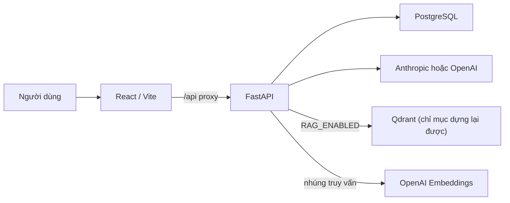

# VieTaxLegal

VieTaxLegal là nền tảng hỗ trợ tra cứu pháp luật và nghiệp vụ thuế bằng tiếng Việt. Dự án gồm
frontend React, backend FastAPI, cơ sở dữ liệu PostgreSQL và lớp AI có thể chuyển đổi giữa
Anthropic và OpenAI.

Phiên bản hiện tại có xác thực tài khoản, chat pháp luật có lịch sử riêng theo từng người dùng và
một pipeline RAG: kho văn bản pháp luật → chỉ mục Qdrant → truy xuất (dense/sparse/hybrid) → câu
trả lời kèm trích dẫn thật. RAG tắt mặc định (`RAG_ENABLED=false`) và cần điền hiệu lực văn bản
trước khi bật (xem [backend/README.md](backend/README.md)).

## Trạng thái tính năng

| Tính năng                                       | Trạng thái      |
| ----------------------------------------------- | --------------- |
| Đăng ký, đăng nhập, đăng xuất và kiểm tra phiên | Hoàn thành      |
| Cookie phiên HTTP-only và mật khẩu Argon2       | Hoàn thành      |
| Chat streaming bằng SSE                         | Hoàn thành      |
| Lưu, mở và xóa lịch sử hội thoại                | Hoàn thành      |
| Anthropic và OpenAI provider (qua LangChain)    | Hoàn thành      |
| Refresh token xoay vòng, vai trò admin, chặn dò mật khẩu | Hoàn thành |
| Rate limit theo phút và theo ngày               | Hoàn thành      |
| Giao diện song ngữ Việt–Anh                     | Hoàn thành      |
| Kho văn bản pháp luật (21 văn bản) và parser     | Hoàn thành*     |
| Chỉ mục Qdrant, embedding OpenAI, dense/hybrid   | Hoàn thành      |
| Citation thật: lưu, trả về và hiển thị nguồn     | Hoàn thành      |
| Bộ đánh giá RAG (câu hỏi, metric, runner, export) | Hoàn thành*     |
| Tính thuế, scan hợp đồng và đính kèm tài liệu   | Chưa triển khai |

\* Cần con người hoàn tất: điền hiệu lực văn bản, bổ sung văn bản còn thiếu và duyệt bộ câu hỏi
đánh giá. Danh sách việc còn nợ nằm trong `plans/261011-1330-rag-legal-retrieval/debts.md`.

Khi RAG tắt hoặc không tìm thấy nguồn, chatbot không hiển thị nguồn hoặc điều luật giả và luôn
cảnh báo người dùng cần kiểm tra lại hiệu lực văn bản.

## Kiến trúc hiện tại



Backend là lớp duy nhất truy cập dữ liệu ứng dụng; frontend không bao giờ kết nối database trực
tiếp. Database là PostgreSQL do Supabase quản lý, backend kết nối qua Session pooler; không cần cài
PostgreSQL trên máy.

## Công nghệ

- Frontend: React 18, Vite, React Router DOM, React Markdown.
- Backend: Python 3.12+, FastAPI, Uvicorn, Pydantic.
- Database: PostgreSQL trên Supabase, SQLAlchemy 2.0, Alembic, Psycopg.
- Xác thực: Argon2 (`pwdlib`), JWT (`PyJWT`) và cookie HTTP-only.
- AI: LangChain (`langchain-anthropic` Messages API hoặc `langchain-openai` Responses API) cho chat và embedding OpenAI; truy xuất Qdrant, hybrid và trích dẫn vẫn tự viết.
- RAG: Qdrant (Docker), embedding OpenAI `text-embedding-3-small`,
  truy xuất dense, sparse (BM25 tự cài) và hybrid (RRF).
- Streaming: Server-Sent Events (SSE).
- Kiểm thử: Pytest, Vitest, Ruff, ESLint và Prettier.
- CI: GitHub Actions cho frontend và backend.

## Cấu trúc repository

```text
VieTaxLegal/
├── backend/
│   ├── app/
│   │   ├── api/           # FastAPI routes và dependencies
│   │   ├── core/          # Cấu hình, bảo mật và lỗi dùng chung
│   │   ├── db/            # SQLAlchemy engine và session
│   │   ├── models/        # Database models
│   │   ├── schemas/       # Pydantic request/response schemas
│   │   └── services/      # Auth, chat, provider và retriever
│   ├── migrations/        # Alembic migrations
│   ├── tests/             # Backend tests
│   ├── .env.example
│   └── README.md          # Tài liệu backend chi tiết
├── frontend/
│   ├── src/
│   │   ├── components/
│   │   │   ├── auth/      # Form và luồng xác thực
│   │   │   ├── chat/      # Giao diện và luồng chat
│   │   │   ├── common/    # Component dùng chung như LanguageToggle
│   │   │   └── landing/   # Các khối của landing page
│   │   ├── context/       # AuthContext và hook useAuth
│   │   ├── data/          # Nội dung tĩnh của landing page
│   │   ├── i18n/          # Internationalization và catalog VI/EN
│   │   ├── pages/         # LandingPage và ChatPage
│   │   ├── services/      # Lời gọi API và SSE client
│   │   └── styles/        # index.css: token và luật nền Tailwind
│   ├── .env.example
│   ├── package.json
│   └── README.md          # Tài liệu frontend chi tiết
├── .github/workflows/     # CI frontend và backend
└── README.md
```

Tài liệu chi tiết theo từng phần nằm trong [backend/README.md](backend/README.md) và
[frontend/README.md](frontend/README.md).

## Yêu cầu

- Node.js 20.19+, 22.13+ hoặc 24+ và npm.
- Python 3.12 trở lên.
- Một project Supabase đang hoạt động (lấy Session pooler URL làm `DATABASE_URL`).
- API key của Anthropic hoặc OpenAI nếu muốn dùng chat thật.

## Chạy nhanh trên Windows

### 1. Backend

```powershell
cd D:\VieTaxLegal\backend
Copy-Item .env.example .env
notepad .env
```

Lấy Session pooler URL của project Supabase (xem
[backend/README.md](backend/README.md#1-kết-nối-database-supabase)), điền vào `DATABASE_URL`, tạo
`JWT_SECRET` có ít nhất 32 ký tự và cấu hình một AI provider. Không đưa database password, JWT
secret hoặc API key lên GitHub.

```powershell
py -m venv .venv
.\.venv\Scripts\python.exe -m pip install -e ".[dev]"
.\.venv\Scripts\python.exe -m alembic upgrade head
.\.venv\Scripts\python.exe -m uvicorn app.main:app --reload --port 5000
```

Giữ terminal backend mở. Kiểm tra:

- Health: <http://127.0.0.1:5000/api/health>
- Swagger: <http://127.0.0.1:5000/docs>

Hướng dẫn đầy đủ về database, migration, API và xử lý lỗi nằm trong
[backend/README.md](backend/README.md).

### 2. Frontend

Mở terminal khác:

```powershell
cd D:\VieTaxLegal\frontend
npm install
npm run dev
```

Mở <http://localhost:3000>. Vite proxy các request `/api` tới backend ở
`http://localhost:5000`.

Chi tiết về scripts, cấu trúc `src/`, luồng xác thực và SSE client nằm trong
[frontend/README.md](frontend/README.md).

## Chạy bằng Docker

Một lệnh dựng Qdrant, backend và frontend (nginx, proxy `/api`).
Không có container Postgres: database vẫn là Supabase, truyền qua `DATABASE_URL`.
Backend **không** tự chạy migration (database là dữ liệu thật); chạy tay khi cần:
`docker compose run --rm backend alembic upgrade head`.

```powershell
$env:DATABASE_URL = "postgresql://postgres.<project-ref>:<password>@aws-0-<region>.pooler.supabase.com:5432/postgres"
$env:JWT_SECRET = "chuoi-ngau-nhien-it-nhat-32-ky-tu"
$env:ANTHROPIC_API_KEY = "..."   # hoặc OPENAI_API_KEY + CHAT_PROVIDER=openai
docker compose up --build
```

Mở `http://localhost:3000`. Có thể đặt các biến trên vào file `.env` ở thư mục gốc (đã gitignore). `RAG_ENABLED=true` để bật RAG; `backend/corpus/` được mount read-only, index Qdrant dựng lại bằng `scripts/ingest_corpus.py`.
Nếu đang chạy container Qdrant riêng (`scripts/start-qdrant.ps1`) thì dừng nó trước, vì cùng cổng 6333.

## Xác thực & phân quyền

- **Access token**: JWT sống ngắn (`ACCESS_TOKEN_MINUTES`, mặc định 15) trong cookie httponly `vietaxlegal_session`.
- **Refresh token**: chuỗi ngẫu nhiên, chỉ lưu hash SHA-256 trong bảng `refresh_tokens`, cookie httponly `vietaxlegal_refresh` giới hạn path `/api/auth`. Mỗi lần dùng sẽ bị thu hồi và cấp token mới (rotation); dùng lại token cũ coi là bị lộ và thu hồi cả phiên. Sống 24 giờ, hoặc 30 ngày nếu chọn "ghi nhớ".
- **Logout** thu hồi phiên phía server; khoá user (`isActive=false`) thu hồi mọi phiên của user đó.
- **RBAC**: cột `users.role` (`user` | `admin`), dependency `require_role(...)` trả `403 FORBIDDEN`. Admin đầu tiên tạo bằng `python scripts/create_admin.py email@...` (không có đường HTTP để tự nâng quyền).
- **Rate limit**: đăng nhập sai 5 lần/15 phút theo `ip|identifier`; đăng ký `REGISTER_MAX_PER_HOUR` (10) lần/giờ theo IP; chat 10 tin/phút và 100 tin/ngày theo user. Bộ đếm đăng nhập/đăng ký nằm trong bộ nhớ process (kiểm tra và đếm nguyên tử dưới một lock, loại key ít dùng nhất khi đầy), nên chỉ đúng với một worker; cần nhiều worker thì chuyển sang Postgres/Redis. Sau nginx, IP lấy từ `X-Forwarded-For` do nginx ghi đè.
- Frontend tự gọi `/auth/refresh` một lần khi gặp `401` rồi gửi lại request (`authFetch` trong `services/api.js`).

## Bảo mật triển khai

nginx gắn CSP, `X-Content-Type-Options`, `Referrer-Policy`, `X-Frame-Options` (HSTS đặt ở lớp TLS phía trước). Ở `APP_ENV=production` các trang `/docs`, `/redoc`, `/openapi.json` bị tắt. Gọi provider chat có timeout 60 giây, embedding lúc truy vấn 15 giây (lỗi thì chat chạy không có nguồn).

## Logging

Cấu hình tập trung ở `app/core/logging.py`. `LOG_LEVEL` (mặc định `INFO`) và `LOG_JSON` (`true` = mỗi dòng một JSON, compose bật sẵn). Mỗi request có `X-Request-ID` (nhận từ client nếu hợp lệ, không thì tự sinh), được trả về trong response header và gắn vào mọi dòng log của request đó. Access log chỉ ghi method, path, status, thời gian; không ghi query string hay body.

## Routes frontend

| Route   | Mô tả                               |
| ------- | ----------------------------------- |
| `/`     | Landing page, đăng ký và đăng nhập. |
| `/chat` | Chat pháp luật; yêu cầu đăng nhập.  |

## API chính

| Method   | Endpoint                       | Mô tả                                        |
| -------- | ------------------------------ | -------------------------------------------- |
| `GET`    | `/api/health`                  | Kiểm tra API và database; `503` nếu DB chết. |
| `POST`   | `/api/auth/email-code`         | Gửi mã xác minh về email (cần SMTP).         |
| `POST`   | `/api/auth/email-code/verify`  | Xác minh mã, trả `proof` dùng khi đăng ký.   |
| `GET`    | `/api/auth/google/login`       | Chuyển hướng sang Google để đăng nhập.       |
| `GET`    | `/api/auth/google/link`        | Chuyển hướng sang Google để liên kết tài khoản (cần đăng nhập). |
| `GET`    | `/api/auth/google/callback`    | Google gọi lại; tạo phiên rồi quay về frontend. |
| `POST`   | `/api/auth/register`           | Đăng ký và tạo phiên.                        |
| `POST`   | `/api/auth/login`              | Đăng nhập bằng email hoặc username.          |
| `POST`   | `/api/auth/refresh`            | Đổi refresh token (xoay vòng), cấp access mới. |
| `POST`   | `/api/auth/logout`             | Đăng xuất, thu hồi refresh token phía server. |
| `GET`    | `/api/auth/me`                 | Lấy người dùng hiện tại.                     |
| `GET`    | `/api/admin/users`             | (admin) Danh sách người dùng.                |
| `PATCH`  | `/api/admin/users/{id}`        | (admin) Đổi `role` / khoá `isActive`.        |
| `GET`    | `/api/chat/usage`              | Số lượt chat đã dùng và còn lại hôm nay.     |
| `GET`    | `/api/chat/conversations`      | Danh sách hội thoại.                         |
| `GET`    | `/api/chat/conversations/{id}` | Nội dung một hội thoại.                      |
| `DELETE` | `/api/chat/conversations/{id}` | Xóa hội thoại.                               |
| `POST`   | `/api/chat/messages/stream`    | Gửi câu hỏi và nhận SSE stream.              |

Mọi lỗi dùng chung envelope `{"error": {"code", "message", "fields"}}`. Frontend ưu tiên dịch theo
`code` bằng ngôn ngữ đang chọn; `message` tiếng Việt từ backend chỉ được dùng làm fallback khi chưa
có bản dịch tương ứng. Bảng mã lỗi đầy đủ nằm trong [backend/README.md](backend/README.md).

## Kiểm tra chất lượng

Backend:

```powershell
cd D:\VieTaxLegal\backend
.\.venv\Scripts\python.exe -m pytest
.\.venv\Scripts\python.exe -m ruff check app tests
.\.venv\Scripts\python.exe -m ruff format --check app tests
```

Frontend:

```powershell
cd D:\VieTaxLegal\frontend
npm run check
```

`npm run check` chạy Vitest, ESLint, Prettier check và production build. Backend tests dùng SQLite
trong bộ nhớ và fake AI provider, không truy cập database thật hoặc API trả phí.

## Bảo mật

- Mật khẩu được băm bằng Argon2 và không lưu plaintext.
- JWT được đặt trong cookie HTTP-only, `SameSite=Lax`; production bật thêm `Secure`.
- Backend từ chối JWT secret yếu và CORS wildcard.
- Mọi truy vấn hội thoại đều lọc theo người dùng hiện tại; UUID của người khác trả `404`.
- Khi chạy trên Supabase, migration tự bật RLS và thu hồi quyền `anon`, `authenticated` trên các
  bảng ứng dụng; trên PostgreSQL thường, bước này được bỏ qua vì hai role đó không tồn tại.
- `.env`, key, certificate, database local, upload và log không được commit.
- API key AI chỉ tồn tại trong backend và không được log hoặc gửi xuống frontend.

## RAG

Pipeline đã triển khai:

```text
Văn bản pháp luật (corpus/, nguồn gốc trong git)
  → trích xuất text (DOCX/PDF)
  → tách theo Điều/Khoản/Điểm, kiểm tra thứ tự và khoảng trống
  → embedding (OpenAI) + vector sparse (BM25 tự cài)
  → Qdrant (dựng lại được từ corpus/)
  → truy xuất dense / sparse / hybrid, chỉ lấy văn bản in_force
  → model trả lời, ghi [n]; chỉ nguồn được trích mới được lưu và hiển thị
```

Số liệu đánh giá nằm ở `backend/rag_eval/results/SUMMARY.md` (sinh bằng `scripts/export_results.py`).
Các số liệu đang đánh dấu `provisional` vì bộ câu hỏi chưa được con người duyệt; chỉ trích dẫn số
liệu trong luận văn sau khi duyệt xong. Cách chạy từng bước xem [backend/README.md](backend/README.md).

Còn lại: điền hiệu lực văn bản, bổ sung văn bản bị cắt/thiếu, duyệt bộ câu hỏi, rồi tinh chỉnh
ngưỡng điểm và cân nhắc rerank dựa trên số liệu đã duyệt.
