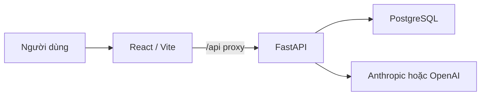

# VieTaxLegal

VieTaxLegal là nền tảng hỗ trợ tra cứu pháp luật và nghiệp vụ thuế bằng tiếng Việt. Dự án gồm
frontend React, backend FastAPI, cơ sở dữ liệu PostgreSQL và lớp AI có thể chuyển đổi giữa
Anthropic và OpenAI.

Phiên bản hiện tại tập trung vào xác thực tài khoản và chat pháp luật có lịch sử riêng theo từng
người dùng. Kho dữ liệu pháp luật, RAG, Qdrant và trích dẫn nguồn thật đang nằm trong roadmap.

## Trạng thái tính năng

| Tính năng                                       | Trạng thái      |
| ----------------------------------------------- | --------------- |
| Đăng ký, đăng nhập, đăng xuất và kiểm tra phiên | Hoàn thành      |
| Cookie phiên HTTP-only và mật khẩu Argon2       | Hoàn thành      |
| Chat streaming bằng SSE                         | Hoàn thành      |
| Lưu, mở và xóa lịch sử hội thoại                | Hoàn thành      |
| Anthropic và OpenAI provider                    | Hoàn thành      |
| Rate limit theo phút và theo ngày               | Hoàn thành      |
| Giao diện song ngữ Việt–Anh                     | Hoàn thành      |
| Kho văn bản pháp luật và Qdrant                 | Chưa triển khai |
| RAG, hybrid search, reranking và citation thật  | Chưa triển khai |
| Tính thuế, scan hợp đồng và đính kèm tài liệu   | Chưa triển khai |

Khi chưa có RAG, chatbot không hiển thị nguồn hoặc điều luật giả và luôn cảnh báo người dùng cần
kiểm tra lại hiệu lực văn bản.

## Kiến trúc hiện tại



Backend là lớp duy nhất truy cập dữ liệu ứng dụng; frontend không bao giờ kết nối database trực
tiếp. Môi trường phát triển dùng PostgreSQL 15 cài trên máy. Có thể trỏ `DATABASE_URL` sang một
PostgreSQL được quản lý (ví dụ Supabase) mà không cần đổi code.

## Công nghệ

- Frontend: React 18, Vite, React Router DOM, React Markdown.
- Backend: Python 3.12+, FastAPI, Uvicorn, Pydantic.
- Database: PostgreSQL 15, SQLAlchemy 2.0, Alembic, Psycopg.
- Xác thực: Argon2 (`pwdlib`), JWT (`PyJWT`) và cookie HTTP-only.
- AI: Anthropic Messages API hoặc OpenAI Responses API.
- Streaming: Server-Sent Events (SSE).
- Kiểm thử: Pytest, Vitest, Ruff, ESLint và Prettier.
- CI: GitHub Actions cho frontend và backend.

## Cấu trúc repository

```text
VieTaxLegal/
├── backend/
│   ├── app/
│   │   ├── api/           # FastAPI routes và dependencies
│   │   ├── core/          # Cấu hình, bảo mật và lỗi dùng chung
│   │   ├── db/            # SQLAlchemy engine và session
│   │   ├── models/        # Database models
│   │   ├── schemas/       # Pydantic request/response schemas
│   │   └── services/      # Auth, chat, provider và retriever
│   ├── migrations/        # Alembic migrations
│   ├── tests/             # Backend tests
│   ├── .env.example
│   └── README.md          # Tài liệu backend chi tiết
├── frontend/
│   ├── src/
│   │   ├── components/
│   │   │   ├── auth/      # Form và luồng xác thực
│   │   │   ├── chat/      # Giao diện và luồng chat
│   │   │   ├── common/    # Component dùng chung như LanguageToggle
│   │   │   └── landing/   # Các khối của landing page
│   │   ├── context/       # AuthContext và hook useAuth
│   │   ├── data/          # Nội dung tĩnh của landing page
│   │   ├── i18n/          # Internationalization và catalog VI/EN
│   │   ├── pages/         # LandingPage và ChatPage
│   │   ├── services/      # Lời gọi API và SSE client
│   │   └── styles/        # CSS toàn cục
│   ├── .env.example
│   ├── package.json
│   └── README.md          # Tài liệu frontend chi tiết
├── .github/workflows/     # CI frontend và backend
└── README.md
```

Tài liệu chi tiết theo từng phần nằm trong [backend/README.md](backend/README.md) và
[frontend/README.md](frontend/README.md).

## Yêu cầu

- Node.js 20.19+, 22.13+ hoặc 24+ và npm.
- Python 3.12 trở lên.
- PostgreSQL 15 trở lên chạy trên máy (hoặc một PostgreSQL từ xa có URL kết nối).
- API key của Anthropic hoặc OpenAI nếu muốn dùng chat thật.

## Chạy nhanh trên Windows

### 1. Backend

```powershell
cd D:\VieTaxLegal\backend
Copy-Item .env.example .env
notepad .env
```

Tạo role và database `vietaxlegal` trong PostgreSQL (xem
[backend/README.md](backend/README.md#1-tạo-database-postgresql)), rồi điền `DATABASE_URL`, tạo
`JWT_SECRET` có ít nhất 32 ký tự và cấu hình một AI provider. Không đưa database password, JWT
secret hoặc API key lên GitHub.

```powershell
py -m venv .venv
.\.venv\Scripts\python.exe -m pip install -e ".[dev]"
.\.venv\Scripts\python.exe -m alembic upgrade head
.\.venv\Scripts\python.exe -m uvicorn app.main:app --reload --port 5000
```

Giữ terminal backend mở. Kiểm tra:

- Health: <http://127.0.0.1:5000/api/health>
- Swagger: <http://127.0.0.1:5000/docs>

Hướng dẫn đầy đủ về database, migration, API và xử lý lỗi nằm trong
[backend/README.md](backend/README.md).

### 2. Frontend

Mở terminal khác:

```powershell
cd D:\VieTaxLegal\frontend
npm install
npm run dev
```

Mở <http://localhost:3000>. Vite proxy các request `/api` tới backend ở
`http://localhost:5000`.

Chi tiết về scripts, cấu trúc `src/`, luồng xác thực và SSE client nằm trong
[frontend/README.md](frontend/README.md).

## Routes frontend

| Route   | Mô tả                               |
| ------- | ----------------------------------- |
| `/`     | Landing page, đăng ký và đăng nhập. |
| `/chat` | Chat pháp luật; yêu cầu đăng nhập.  |

## API chính

| Method   | Endpoint                       | Mô tả                                        |
| -------- | ------------------------------ | -------------------------------------------- |
| `GET`    | `/api/health`                  | Kiểm tra API và database; `503` nếu DB chết. |
| `POST`   | `/api/auth/register`           | Đăng ký và tạo phiên.                        |
| `POST`   | `/api/auth/login`              | Đăng nhập bằng email hoặc username.          |
| `POST`   | `/api/auth/logout`             | Đăng xuất.                                   |
| `GET`    | `/api/auth/me`                 | Lấy người dùng hiện tại.                     |
| `GET`    | `/api/chat/conversations`      | Danh sách hội thoại.                         |
| `GET`    | `/api/chat/conversations/{id}` | Nội dung một hội thoại.                      |
| `DELETE` | `/api/chat/conversations/{id}` | Xóa hội thoại.                               |
| `POST`   | `/api/chat/messages/stream`    | Gửi câu hỏi và nhận SSE stream.              |

Mọi lỗi dùng chung envelope `{"error": {"code", "message", "fields"}}`. Frontend ưu tiên dịch theo
`code` bằng ngôn ngữ đang chọn; `message` tiếng Việt từ backend chỉ được dùng làm fallback khi chưa
có bản dịch tương ứng. Bảng mã lỗi đầy đủ nằm trong [backend/README.md](backend/README.md).

## Kiểm tra chất lượng

Backend:

```powershell
cd D:\VieTaxLegal\backend
.\.venv\Scripts\python.exe -m pytest
.\.venv\Scripts\python.exe -m ruff check app tests
.\.venv\Scripts\python.exe -m ruff format --check app tests
```

Frontend:

```powershell
cd D:\VieTaxLegal\frontend
npm run check
```

`npm run check` chạy Vitest, ESLint, Prettier check và production build. Backend tests dùng SQLite
trong bộ nhớ và fake AI provider, không truy cập database thật hoặc API trả phí.

## Bảo mật

- Mật khẩu được băm bằng Argon2 và không lưu plaintext.
- JWT được đặt trong cookie HTTP-only, `SameSite=Lax`; production bật thêm `Secure`.
- Backend từ chối JWT secret yếu và CORS wildcard.
- Mọi truy vấn hội thoại đều lọc theo người dùng hiện tại; UUID của người khác trả `404`.
- Khi chạy trên Supabase, migration tự bật RLS và thu hồi quyền `anon`, `authenticated` trên các
  bảng ứng dụng; trên PostgreSQL thường, bước này được bỏ qua vì hai role đó không tồn tại.
- `.env`, key, certificate, database local, upload và log không được commit.
- API key AI chỉ tồn tại trong backend và không được log hoặc gửi xuống frontend.

## Roadmap RAG

Hướng triển khai dự kiến:

```text
Văn bản pháp luật
  → trích xuất/OCR
  → tách theo Điều/Khoản/Điểm
  → embedding
  → Qdrant (vector + metadata)
  → hybrid retrieval
  → rerank khi cần
  → model trả lời kèm citation thật
```

Ưu tiên trước khi thêm nhiều model là xây bộ đánh giá câu hỏi pháp luật có nguồn chuẩn, đo khả năng
tìm đúng điều luật, độ chính xác citation, hallucination, độ trễ và chi phí.
